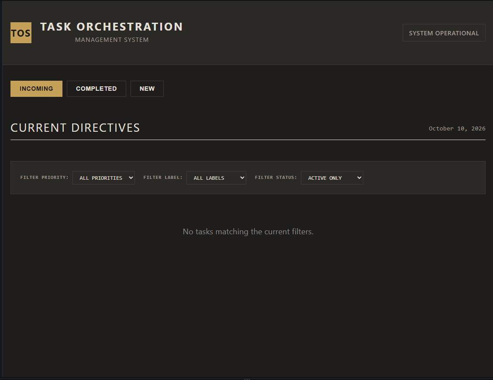
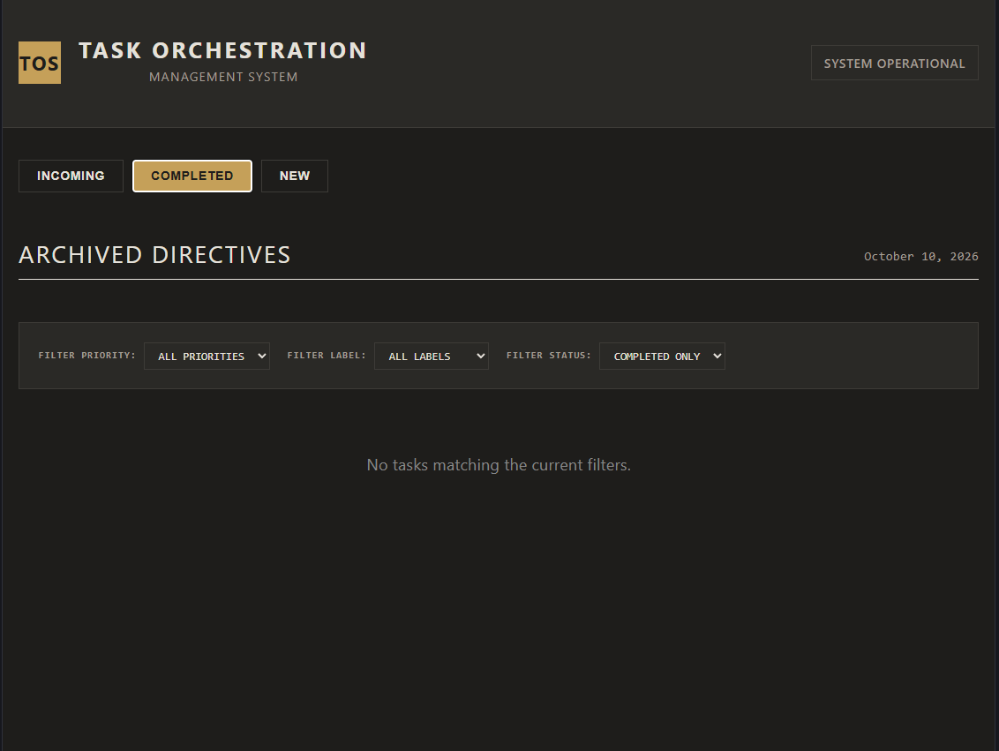
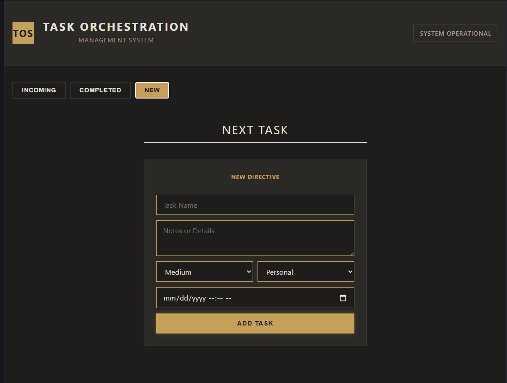

# 🛠️ Task Orchestration Management System

A high-precision, architecturally-styled task management application designed for directive-based organization. This system focuses on clarity, priority, and operational efficiency, utilizing a sharp, minimalist aesthetic.

## 📺 System Overview


## 🚀 Features

- **Directive Management**: Create, edit, and terminate tasks with precision.
- **Intelligent Prioritization**: Categorize tasks by priority levels (Urgent, High, Medium, Low) with weighted sorting.
- **Tabbed Interface**: 
  - **Incoming**: Focused view for active directives.
  - **Completed**: An archive of successfully executed directives.
  - **New**: A dedicated space for initializing new directives.
- **Advanced Filtering**: 
  - Filter by Priority, Label, or Status.
  - **Upcoming Filter**: Quickly identify tasks with future due dates.
  - **Live Counts**: See exactly how many tasks exist in each priority/label category before filtering.
- **Persistence**: LocalStorage integration ensures your directives are saved across sessions.
- **Overdue Alerts**: Visual indicators for tasks that have passed their deadline.

## 🖼️ Interface Gallery

### 📥 Incoming Directives
Manage your current active tasks with live filtering and priority sorting.


### ✅ Archive
A clean record of all successfully completed tasks.


### ➕ Directive Initialization
A focused, distraction-free environment for adding new tasks to the system.


## 🎨 Aesthetic & Design

The application follows a "System Operational" design language:
- **Architectural Edges**: Zero border-radius for a sharp, structured look.
- **Monochromatic Base**: High-contrast palette with strategic use of priority-based colors.
- **Typographic Focus**: Heavy use of uppercase labels and monospace fonts for a technical, "command-center" feel.

## 🛠️ Tech Stack

- **Frontend**: React 19
- **Build Tool**: Vite
- **State Management**: React Context API
- **Styling**: CSS-in-JS (Inline Styles)
- **Utilities**: date-fns

## 🏁 Getting Started

### Prerequisites

- [Node.js](https://nodejs.org/) (Latest LTS recommended)
- npm or yarn

### Installation

1. **Clone the repository:**
   ```bash
   git clone https://github.com/your-username/priority-task-manager.git
   cd priority-task-manager
   ```

2. **Install dependencies:**
   ```bash
   npm install
   ```

3. **Run the development server:**
   ```bash
   npm run dev
   ```

4. **Open in browser:**
   Navigate to the URL provided by Vite (usually `http://localhost:5173`).

## 📦 Build & Deployment

To create a production-ready build:
```bash
npm run build
```
The output will be in the `dist/` folder, ready for deployment to platforms like Vercel, Netlify, or GitHub Pages.

---
*System Operational. Efficiency Optimized.*
